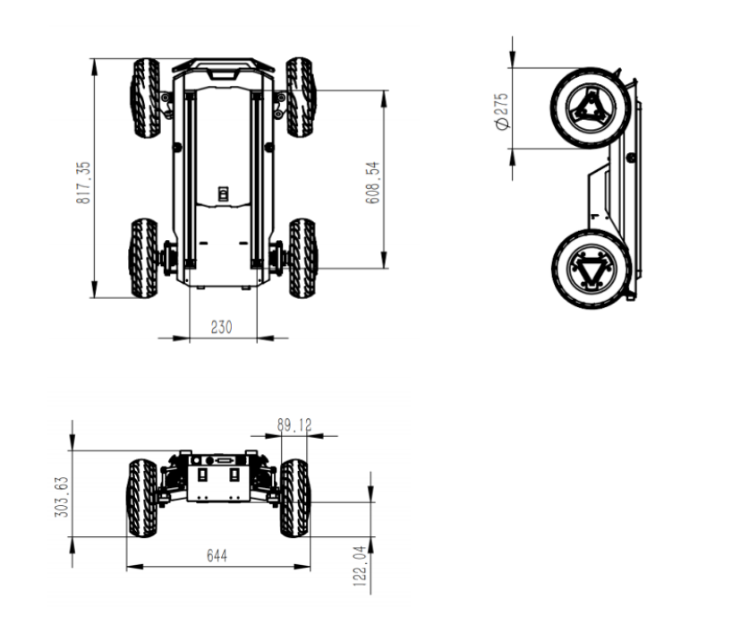
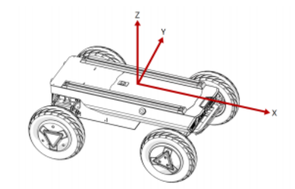
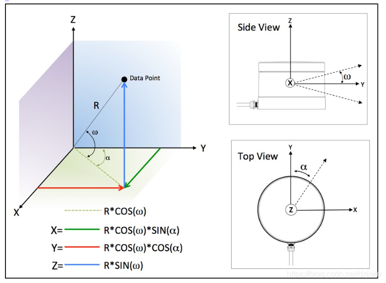
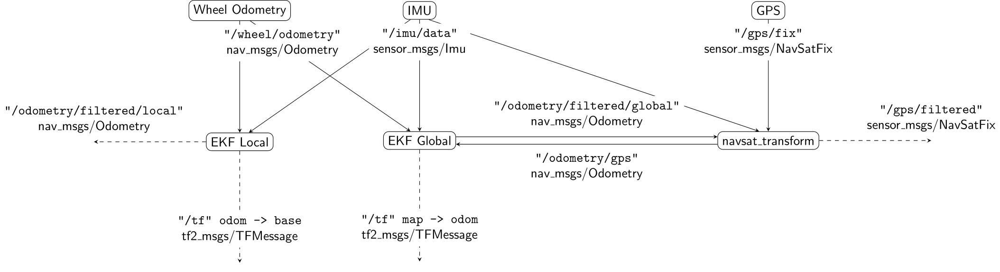
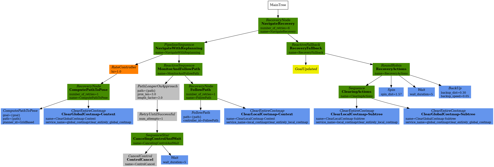

# hunter_se

该工作空间基于hunter_se移动底盘，面向3D-SLAM、路径规划等场景

**==说明==**：

1. 后面的很多内容都是过程中写的，目前没有太多时间仔细检查和修改，后面有时间再修改
2. 主要修改和检查的是**基础导航**部分的指令运行与结果保存
3. 项目编译建议使用`colcon build --symlink-install --parallel-workers 4 --executor sequential`，限制线程防止卡死；**liorf特别容易卡死**


# 问题

```
1. conda隔离python环境？
2. 仿真时TF_OLD_DATA
	启动gazebo、lio_sam后报错：[liorf_imuPreintegration-2] Warning: TF_OLD_DATA ignoring data from the past for frame base_link at time 3.134845 according to authority Authority undetectable
    原因：
        gazebo的底盘插件配置中，<publish_odom_tf>true</publish_odom_tf>，则会发布odom->base_link的TF
        lio_sam的配置中，订阅odom、imu、lidar话题，融合后会发布 融合后的更准确的odom话题 和 odom->base_link的TF
        两个TF变换同时发布，Gazebo 以 sim_time 高频发布 TF，LIO-SAM 以 lidarOdomTime（激光里程计时间戳）发布，当 LIO-SAM 发布的时间戳比 Gazebo 插件已发布的最新时间戳更旧时，TF2 buffer 就会报错如上TF_OLD_DATA
	解决方案：
        1. 禁止gazebo的底盘插件发布TF：<publish_odom_tf>false</publish_odom_tf>（此时根据urdf发布的静态TF正常）
            出现问题：启动lio_sam后，rviz出现车辆沿z轴翻转180度，并且所有 轮子->base_link->odom的TF树断裂，导致轮子无法加载，其他部件正常
        2. 禁止lio_sam发布TF：在src/imuPreintegration.cpp中，注释tfOdom2BaseLink->sendTransform(trans_odom_to_base_link);
            问题：不再报错TF_OLD_DATA，所有模型正常，但由底盘发布的odom话题存在累积误差，因此odom->base_link的TF不准确
            是否可以再额外加入robot_localization包来发布融合后的odom->base_link的TF？
3. 真实底盘驱动sdk，没有发布odom->base_link？没有在源码中看到tf发布的内容和参数配置，这与ros1的sdk源码不同
	解决：
		有发布odom->base_link的实现，在/hunter_ros2/hunter_base/include/hunter_base/hunter_messenger.hpp中PublishOdometryToROS函数；但是没有参数化，导致禁止发布只能在源码中注释相关内容；
		可以修改源码，加入publish_tf的bool变量，将其参数化，通过launch的参数配置决定是否发布tf（方便后续使用其他功能包发布更准确的TF时，禁用底盘tf发布）
		
4. 各个传感器时间同步的问题（ptpd2、use_sim_time？）
5. imu、相机等传感器标定！（lio_sam中的参数！）
6. 命令空间的加入，避免多机器人仿真时冲突（通信、控制等）
7. 基于深度相机等传感器的 自定义代价地图层，引入其他数据改善避障效果
8. 引入代价地图过滤器：即在地图上某些位置进行注释，以便进行特定操作，例如将某些区域排除在外以避免在这些区域内进行路径规划
9. 性能指标：
	轨迹跟踪/路径规划中可以使用rqt plot，将目标点位姿（pose.x）等和实时位姿（tf transform.pose.x，或通过话题发布path）进行对比，绘制曲线图，作为结果展示			


10. 3d建图与格式转换
    octomap投影生成的地图会带很多杂点（pcd点云越密集生成的地图效果越差），并且会把底盘3d建图时脚底的圆环雷达线投影到地面（这个线是什么？）
    pcd2pgm滤波后得到的地图就好很多，pcd点云越密集生成的地图效果越好（障碍物边界清楚，但可能带一些杂点）
    lio_sam和carto3d，可能因为参数设置的原因后者生成的pcd点云更密集，相应的文件更大（630kb vs 48MB），处理起来更慢（pbstream-ply-pcd）
    lio_sam的优点是建图完成后直接生成pcd地图，而carto3d还要录制bag，并单独转换和保存地图

    在3d-pcd点云地图转2d地图的过程中，往往涉及坐标系转换的问题（3d建图时有固定的坐标系，例如carto3d的tracking_frame；liosam的mapFrame）
    在3d建图时，carto3d根据tracking_frame作为实时跟踪运动的基准坐标系，通常选 IMU 或雷达坐标系，用于解算传感器的实时位姿、融合多传感器数据，因此在rviz中，map坐标系就在tracking_frame的同一z平面（即在imu的中心；为什么和tracking_frame没有重叠？）；在assets_writer导出时，可以设置tracking_frame = "map"，设置点云导出的目标参考坐标系，决定最终输出的全局点云统一在哪个坐标系下表达
    lio_sam建图则需要根据urdf和实际安装位置，单独确定imu和lidar的坐标转换关系及对应的外参矩阵（carto3d根据urdf静态tf自行确认）；在rviz建图时，map坐标系和地面重合的，这与carto3d不同；
    二者建图时都会出现map地图坐标系在地面上，而车在地面下，但是最终生成的点云都是高度比较完整的？暂时没看出来有什么影响；但是也没搞清楚为什么有这种现象，ai说只是rviz视觉上的影响，对后续真实导航没有影响

    而在octomap构建的时候，pcd_to_pointcloud节点需要确定播放的点云的tf_frame，octomap_server_node也需要frame_id；
    目前还没有搞清楚整个坐标转换的过程和怎么设置；
    但实际转换到2d后，就是一个平面，无所谓坐标系，只要原点正确即可

    在仿真时，如果gazebo世界复杂，模拟物体较多，模拟3d雷达线较多，频率较高时，会出现无法稳定建图的情况（原因有多种：核心因素是电脑性能问题，导致雷达数据模拟的打出-反射-计算、建图融合计算实时修正定位等算法和计算无法同步）

待做：
	1. 修正octomap投影地图无法用的问题
	2. 整理功能包，代码和对应的文档，完善后同步到hunter_se_real中
	3. 备份
	4. 详细了解gazebo仿真逻辑将urdf的lidar
    5. imu等传感器的安装位置macro参数化，方便在加载是传入
    6. 代码没有形成统一的风格，例如urdf.xacro、launch.py等

回答：
    3d雷达gazebo模拟中，由于雷达安装位置的原因，雷达的部分线束会打到地面，从而在底盘底部形成点云圆环；
    如果在后续3d点云转2d地图时，无法过滤这些圆环，会导致地面上也有障碍物，从而影响导航
	在导航时，加载的map坐标系也是建图时相同，即车在地面下，而map坐标系与地面重合（lio_sam；z=0）
		这样会有一个问题，假设障碍物在地面下方，那么以当前坐标系建图，3d雷达能扫描到障碍物在地面下方吗
			如果扫描到了，能够在对应位置生成占据地图；但是导航时地图坐标系仍在地面上方，如果使用2d雷达，那么就扫描不到该障碍物，也就无法导航


11. 3d建图转2d后，2d导航时其他范围内的动/静态障碍物
    问题：低矮/高 障碍物
        静态：
            如果障碍物高度 低/高 于 2d 导航时使用的单线雷达，这样即使静态地图中有占据信息，实时导航时，雷达也无法扫描到该障碍物
            解决：Nav2 的代价地图（Costmap）分为多层，其中static_layer（静态层）会永久加载生成的 pgm 地图中的障碍物，这些障碍是先验存在的，不依赖实时传感器检测。
            效果：哪怕导航用的单线 2D 雷达安装高度高于障碍物（比如雷达装在机器人顶部 0.8m 高，障碍物只有 0.3m 高），只要 3D 建图时扫到了这个障碍、投影进了静态地图，导航规划时就会主动绕开，不会碰撞。

        动态：障碍物是建图后新增的动态低矮障碍
            动态障碍物依赖 Nav2 的obstacle_layer（障碍层）实时检测，完全靠导航传感器输入。如果单线 2D 雷达扫不到（高度不在雷达扫描平面内），障碍层就不会标记这个障碍，规划器会认为前方是可通行区域，直接撞上去。
            解决：
                方案一：
                    使用pointcloud_to_laserscan包完成3d雷达转2d激光，通过截取一定高度的雷达，保留一定范围的动态避障能力
                方案二：直接用 3D 点云做体素代价地图（精度最高）
                    Nav2 自带voxel_layer体素层，直接订阅 3D 点云话题，在三维空间中检测障碍物，再投影到 2D 代价地图，支持多高度层的障碍检测，比转虚拟激光保留更多信息，适合复杂环境
	说明：
		1. nav2中costmap代价地图可以由多个层叠加而成，也可以自定义代价地图层，用于特定行为（例如禁行区、速度限制区域mask等）
		例如：plugins: ["static_layer", "obstacle_layer", "inflation_layer", "voxel_layer"]；包含静态、障碍物、膨胀、体素层
		而其中的voxel_layer体素层可以直接订阅 点云话题/LaserScan，前者信息丰富，可用于动态障碍物检测；后者计算量更小
		此外，voxel_layer可以配置多个观测输入源，例如雷达的点云、深度相机的点云 同时作为观测源，实现某种程度上的数据融合？
			两个观测源独立进行 marking 和 clearing，它们操作的体素是共享的。这意味着：
                雷达检测到高处障碍 → 标记体素列
                深度相机检测到低处障碍 → 标记同一体素列
                两者互补，同一个代价图层合并所有观测
		具体体素层用法详见ros2学习相关内容

其他：
1. lio_sam相关的报错，例如gtsam、lio_sam单独发布了odom->lidar_link的单独tf，破坏了正常的tf tree等问题，通过以下方式解决：
	1. 进入github的lio_sam工程，在issues界面查看是否有相同问题与解答（或者自行提问）
		例如：https://github.com/TixiaoShan/LIO-SAM/issues/519
	2. 上网查找是否有使用相同算法的视频/博客等，看评论区是否有相同问题与解答
	3. 根据终端问题，分析源码解决 或 进入ros官网查看（针对ros层面的问题）
		例如：https://wiki.ros.org/tf/Errors%20explained
	4. 询问ai/其他技术支持	
2. 没有在跑 ROS2 节点，但 ros2 topic list 还能列出一堆 topic，ros2 node list也有一堆节点
	https://blog.csdn.net/Json_Zeng/article/details/158619284	
	这种情况会导致多个节点重复发布相同的话题，例如/tf，这时再启动新启动的节点可能会报错，TF_OLD_DATA等
3. 在一些节点启动时，往往需要重映射/修改一些参数名称，例如节点订阅的话题名称等，当修改参数无效时
    首先通过网络搜索或AI确定这个参数的名称是否正确
    如果没有明确的答案，那么就去查找源码的具体实现；
    以修改话题名称为例，如果源码中参数名称是写死的，没有参数化，无法修改，那么就对该节点别的话题进行重映射，映射到需要修改的话题名称
    （举例:octomap节点发布的话题是project_map，并且该topic话题名称是写死的，因此无法在node标签中通过argument或parameter等方式修改，只能做话题重映射）
    
    


```


# 注意事项

```
1. 在正式测试、运行前，请根据实际环境、硬件等，确保参数一致性，调整各功能包、节点、算法的参数
	激光雷达：线数、分辨率、扫描频率、坐标系、输出点云话题、yaml文件、launch文件等
	imu：launch文件、波特率、通信方式等
	gnss-rtk：launch文件、网络rtk/自建基站、	
	lio_sam：yaml文件配置、launch文件
	carto2d/3d：yaml文件、launch文件
	robot_localization：yaml文件、launch文件
	point_to_laserscan：节点参数设置
	octomap_server：2d投影高度、概率模型参数、地图分辨率等节点参数设置
	pcd2pgm：yaml文件、launch文件
	map_save/bag_save：launch文件
	nav2：yaml文件
	gazebo：仿真时间、步长、verbose、gui
	urdf/xacro：静态tf、tf树、坐标变换关系
	传感器时间同步！！！
```


# 项目说明

```
环境
	ubuntu22.04
	ros-humble
仿真
	环境：gazebo模拟物理世界；
	传感器：gps和imu的gazebo插件采用官方的；vlp16的gazebo插件
	建图：测试了LIO-SAM、cartographer
	定位：采用amcl全局定位，发布map-odom的tf变换；局部定位暂时由底盘驱动节点根据轮式里程计数据发布odom->base_link的tf；
	导航：采用nav2框架
真实场景
	针对现实场景，引入了部分传感器的驱动包，并做了简单的导航测试，但完整的流程并没有细化和修改

坐标变换
	map → odom：由amcl发布
    odom → base_link：轮式里程计节点
    base_link → laser：urdf 固定静态 TF
    
方案选择    
	1. 引入了robot_localization功能包，目前还没有用于全局/局部融合定位；该功能包的使用需要修改对应的launch和config配置文件
```


# 环境配置

**运行环境**

- ubuntu22.04
- ros2-humble

**依赖**

```
hunter_se底盘
	sudo apt-get install ros-humble-gazebo-*
	sudo apt-get install ros-humble-ackermann-steering-controller
	sudo apt-get install ros-humble-control-*
	sudo apt-get install ros-humble-rqt-robot-steering 
	sudo apt install -y can-utils
2D雷达N10P/3D雷达RS16/VLP16
	sudo apt install libpcap-dev
GNSS-RTK-G70模块
	sudo apt install ros-noetic-catkin-virtualenv
	sudo apt install python3-testresources
	sudo apt install python3-pip
    pip3 install serial
    pip3 install pyserial
    pip install pyproj
IMU
	sudo apt install python3-numpy python3-serial
Gemini Pro
	sudo apt install ros-humble-image-transport ros-humble-image-transport-plugins ros-humble-compressed-image-transport
    sudo apt install ros-humble-image-publisher ros-humble-camera-info-manager
    sudo apt install ros-humble-diagnostic-updater ros-humble-diagnostic-msgs ros-humble-statistics-msgs
    sudo apt install ros-humble-backward-ros libdw-dev

robot-localization
	sudo apt install ros-humble-diagnostic-updater
	sudo apt install ros-humble-geographic-msgs
	sudo apt install libgeographic-dev geographiclib-tools
LIO-SAM
    cd catkin_ws/src/
    git clone https://github.com/TixiaoShan/LIO-SAM.git   
GTSAM
	新建终端，进入根目录
    git clone https://github.com/borglab/gtsam.git
    cd gtsam
    git checkout 4.0.3
    mkdir build && cd build
    cmake -DGTSAM_WITH_METIS=ON \
          -DGTSAM_BUILD_WITH_MARCH_NATIVE=OFF \
          -DGTSAM_BUILD_EXAMPLES_ALWAYS=OFF \
          -DGTSAM_BUILD_UNSTABLE=ON \
          -DGTSAM_USE_SYSTEM_EIGEN=ON ..
    make -j4
    sudo make install
cartographer
	源码编译：
        git clone https://ghproxy.com/https://github.com/ros2/cartographer.git -b ros2
        git clone https://ghproxy.com/https://github.com/ros2/cartographer_ros.git -b ros2
	apt安装：
		sudo apt install ros-humble-cartographer
		sudo apt install ros-humble-cartographer-ros
	sudo apt install libabsl-dev
	sudo apt install libceres-dev
	sudo apt install liblua5.3-dev lua5.3
	sudo apt install libcairo2-dev
	sudo apt install ros-humble-nav2-map-server

octomap
	sudo apt install -y ros-humble-pcl-ros
	sudo apt install ros-humble-octomap ros-humble-octomap-msgs ros-humble-octomap-ros ros-humble-octomap-server
	
nav2
	apt安装
		sudo apt install ros-humble-nav2-*
	源码编译
		git clone https://ghproxy.com/https://github.com/ros-planning/navigation2.git -b humble

其他
	sudo apt install ros-humble-xacro
	sudo apt install pcl-tools
	sudo apt install ros-humble-joint-state-publisher ros-humble-joint-state-publisher-gui
	sudo usermod -a -G dialout your_user_name（将当前用户加入dialout组）
	
	
鱼香rosdepc一键安装依赖
	wget http://fishros.com/install -O fishros && . fishros
	然后在工作空间下，终端运行下面的命令
	rosdepc install -r --from-paths src --ignore-src --rosdistro $ROS_DISTRO -y

说明
	1. 具体的依赖安装请结合编译后终端输出情况处理
```

# 文件系统

```
├── reference：部分开源代码，用于借鉴思路（编译时请移除此文件夹）
├── docs：相关文档与用户手册
├── src：核心代码实现     
    ├── hunter_se_common：ros工程的通用功能包
    │   ├── cartographer：cartographer建图算法实现
    │   ├── hunter_se_description：包含底盘及其他硬件的描述文件
    │   ├── liorf：lio_sam算法适配VLP16的版本，目前仅在仿真环境下测试；真实场景下需要配置IMU
    │   ├── plugins：包含一些通用的插件/功能包，如：pointcloud_to_laserscan等
    │   └── robot_localization：用于多传感器（IMU、GNSS、odometry）融合定位的功能包
    ├── hunter_se_real：项目在真实环境下相关的功能包，需要先配置好hunter_se实车的相关环境和依赖
    │   ├── bring_up：用于一键启动的功能包，核心是launch文件；
    │   ├── drivers：真实硬件的相关驱动
    │   ├── nav2：真实场景下导航的相关配置
    │   └── slam_carto：真实场景下carto建图的相关配置
    ├── hunter_se_sim：项目在仿真环境下相关的功能包
    │   ├── drivers：仿真环境下模拟传感器、底盘的插件
    │   ├── sim_bring_up：一键启动
    │   ├── sim_carto：carto建图仿真
    │   ├── sim_gazebo：gazebo仿真
    │   └── sim_nav2：nav2仿真
    ├── robot_msgs：机器人自定义的相关消息
    ├── robot_rviz_plugins：自定义的rviz插件
    └── robot_utils：相关utils(这几个文件夹主要还是学习其他成熟的工程配置，目前还没有实际内容)
└── README.md

说明
	1. hunter_se_real和hunter_se_sim的目录结构类似，核心是参数和配置不同；主要还是介绍仿真环境下的使用
```


# 硬件

## 工控机

```
型号：Jetson Orin NX Super
供电：9-19V
```

## 底盘

**工作电压**

```
拓展电源：电压范围 24.5~26.8 V；最大电流 10A ；总功率不超过 240W
工作电压：24.5-26.8 V
当系统检测到电池电压低于 安全电压24V 后，外部扩展设备会被主动切断，注意防止外部扩展设备数据丢失
```

**外形尺寸**



**坐标系base_link**

在车体表面，建立车身参考坐标系如下图：




**底盘测试**

```
使能 gs_usb 内核模块；设置 500k 波特率和使能 can-to-usb 适配器
sudo modprobe gs_usb
sudo ip link set can0 up type can bitrate 500000
candump can0
source install/setup.bash
ros2 launch hunter_base hunter_base.launch.py
ros2 run teleop_twist_keyboard teleop_twist_keyboard
```


## VLP16

[VLP-16用户手册 第九章 传感器数据](https://blog.csdn.net/dzjoke/article/details/119351453)

https://github.com/ros-drivers/velodyne

[ubuntu 22.04 Ros2 humble使用Velodyne VLP16](https://blog.csdn.net/HuBen99/article/details/150491938)

**物理参数**

```
自身外形尺寸/m
	1. 半径：约0.0516m
	2. 高度：约0.717m
	3. 质量：0.84kg

线数：16
每根激光的间隔角度：
探测范围：

实际安装尺寸/m
	1. 支架
		长度：约0.28m;
		安装位置：以车体中心为原点，base_link为坐标系；(x,y,z)=(0.07, 0.0, 0.14)
	2. 雷达安装位置：
		以支架中心为原点，support_lidar_link为坐标系；(x,y,z)=(0.0, 0.0, 0.18)
```

**坐标系**



```
采用右手坐标系，线缆正前方为Y轴正向，右侧为X轴正向，Z轴垂直于地面向上（硬件坐标系）
	velodyne的ROS驱动包中，默认使用坐标变换来调整坐标系
	即ROS下velodyne雷达坐标系x轴指向上图的y轴正方向，y轴指向x轴父方向，这与硬件出厂坐标系有所区别
航向角（α）以Y轴为起点，逆时针增加，代表激光雷达水平扫描的角度。
俯仰角（ω）以X-Y平面为起点，向上为正，向下为负，代表每个激光发射器出线角度，VLP-16有16对激光器，在出厂时已固定了角度
```

**描述与驱动文件**

```
-hunter_se_description/urdf/VLP16.urdf.xacro
	支架、雷达等部件的描述文件，定义外观、尺寸、位置、惯量等属性
	定义gazebo环境中，模拟雷达插件的相关参数（分辨率、通信插件、话题、测距范围等）
-hunter_se_description/urdf/VLP16.gazebo.xacro
	velodyne激光雷达，gazebo插件实现（模拟雷达），编译后生成libgazebo_ros_velodyne_laser.so动态库文件
-drivers/velodyne
	velodyne激光雷达驱动文件，用于物理VLP雷达硬件的测试
```

**仿真使用**

```
1. 集成雷达的描述文件、驱动文件(velodyne_gazebo_plugins ros2)，运行gazebo与rviz仿真环境
	urdf.gazebo.xacro中配置gazebo插件（libgazebo_ros_velodyne_laser.so）
2. rviz添加组件PointCloud2，订阅话题/velodyne_points，即可在rviz中显示雷达数据
```

**真实场景测试**

```
0. 下载驱动文件
	https://github.com/ros-drivers/velodyne（ros2 humble）
1. 将功能包velodyne放入对应目录下，如～/src/velodyne，并编译
	colcon build --symlink-install
2. 网口配置
	连接电脑与velodyne雷达
	进入ubuntu-设置-网络-有线，配置为ipv4，方式设置为手动ip地址、掩码以及网关设置为
	ipv4地址：192.168.1.200 子网掩码：255.255.255.0 网关：192.168.1.2
	（其中ipv4地址不能为 192.168.1.201 ，这个是雷达的地址）
	浏览器打开http://192.168.1.201，进入雷达的设置界面
		设置Host（Destination）的IP Address为192.168.1.200，data port为2368
		点击后面的set，下拉到最后save configuration
	ping 192.168.1.201
3. 运行驱动文件
	source install/setup.bash
	ros2 launch velodyne velodyne-all-nodes-VLP16-launch.py
4. 打开rviz2，frame_id设置为velodyne，添加PointCloud2组件，Topic选择 /velodyne_points
```


## 深度相机

**realsense**

[ROS使用RealSense-D435i](https://blog.csdn.net/u013454780/article/details/133255733)

**外形尺寸**

```
自身外形尺寸/m
	1. 长宽高：0.09，0.02505，0.025

实际安装尺寸/m
	1. 支架
		长度：约0.04m;
		安装位置：以车体中心为原点，base_link为坐标系；(x,y,z)=(0.30, 0.0, 0.02)
	2. 相机安装位置：
		以支架中心为原点，support_realsense_link为坐标系；(x,y,z)=(0.0, 0.0, 0.0325)
```

------


**gemini pro**

```
型号
	device unique id: 3-1.2-22
	Serial number: AY2M543005L
	Device name SV1301S_U3	
```

**测试**

```
1. 下载OrbbecSDK_ROS2，下载依赖
2. 设置udev规则；
    cd  ~/src/OrbbecSDK_ROS2/orbbec_camera/scripts
    sudo bash install_udev_rules.sh
    sudo udevadm control --reload-rules && sudo udevadm trigger
3. 编译运行
    colcon build --symlink-install
    source install/setup.bash
    ros2 launch orbbec_camera gemini_ew.launch.py
4. ros2 topic 或 rviz2 检查输出
```


# 软件

## robot_localization

**robot_localization工作流程示意图**




# 技术路线

## 数据流

```
移动底盘
    BMS电源管理：
    odom轮式里程计（nav_msgs::Odometry）：hunter_se底盘驱动节点，解析can通道底盘轮式编码器相关数据，发布轮式里程计数据
        详见src/drivers/hunter_ros/hunter_base/src/hunter_messenger.cpp中PublishOdometryToROS方法

激光雷达

robot_localization
	navsat_transform_node：把 /gps/fix（经纬度）转换为odom局部坐标系下的 odometry/gps
	ekf_localization_node：把odom（轮式里程计）、odometry/gps、imu/data等数据，融合成连续稳定的 odom->base_link的估计，输出滤波后的/odometry/filtered（nav_msgs/Odometry），并发布 odom->base_link TF
amcl

```


------


## 坐标变换

**坐标系设置**

```
map_frame_id：map
odom_frame_id：odom
base_frame_id：base_link
lidar：lidar
cmd_vel：cmd_vel
```


## SLAM

### Cartographer

https://github.com/ros2/cartographer

https://google-cartographer.readthedocs.io/en/latest/index.html

**==流程==**

```
carto3d建图：
	建图时所有的数据全部转换到lua配置文件的tracking_frame下（一般为imu坐标系）
	carto3d构建的地图坐标系map_frame一般与imu坐标系位于同一z轴，这样导致地图通常不在地面（z不等于0）
	点云数据会扫描到垂直方向视场角内的障碍物，然后carto将其投影到map地图上
	通过cartographer_assets_writer导出点云pcd文件（转换到assets_writer_3d.lua文件中配置的tracking_frame坐标系下）
	导出的pcd文件是完整的点云数据，经过octomap/pcd2pgm处理后得到投影后的pgm地图

```

**参数配置**

作为一个优秀的开源库，Cartographer提供了很多可以配置的参数，虽然灵活性提高了，但同时也提高了使用难度（需要对参数进行调节配置）

Cartographer参数是使用lua文件来描述的（lua中的注释采用 -- 开头）

**Cartographer 2D**

```
前端参数
    文件：trajectory_builder_2d 
    路径：/cartographer/configuration_files/trajectory_builder_2d.lua
    参数：
    	-- 是否使用IMU数据
        use_imu_data = true, 
        -- 深度数据最小范围
        min_range = 0.,
        -- 深度数据最大范围
        max_range = 30.,
        -- 传感器数据超出有效范围最大值时，按此值来处理
        missing_data_ray_length = 5.,
        -- 是否使用实时回环检测来进行前端的扫描匹配
        use_online_correlative_scan_matching = true
        -- 运动过滤，检测运动变化，避免机器人静止时插入数据
        motion_filter.max_angle_radians
后端参数
    文件：pose_graph.lua（该文件主要和地图构建有关）
    路径：/cartographer/configuration_files/pose_graph.lua
	参数：
        --Fast csm的最低分数，高于此分数才进行优化。
        constraint_builder.min_score = 0.65
        --全局定位最小分数，低于此分数则认为目前全局定位不准确
        constraint_builder.global_localization_min_score = 0.7	
Carotgrapher_ROS参数配置
	文件：backpack_2d.lua
	路径：/cartographer_ros/cartographer_ros/configuration_files/backpack_2d.lua
	作用：该部分参数主要是用于和ROS2进行通信和数据收发的配置，比如配置从哪个话题读取里程计数据，从哪个话题来获取深度信息（雷达）

```


**测试**

```
创建cartographer启动功能包，完善文件目录，配置参数（传感器话题、坐标系设置等），编辑启动文件
	ros2 pkg create sim_cartographer
	cd sim_cartographer && mkdir -p config/carto_2d.lua launch/sim_carto2d.launch.py map
    修改CmakeLists.txt，添加安装指令
        install(
          DIRECTORY config launch 
          DESTINATION share/${PROJECT_NAME}
        )	
编译
	colcon build --symlink-install --packages-select cartographer cartographer_ros sim_cartographer
	source install/setup.bash
启动gezebo或真实硬件驱动（雷达、imu），确保数据和话题正常发布
	ros2 launch hunter_se_gazebo gazebo.launch.py use_rviz:=false
运行cartographer			
	ros2 launch sim_cartographer sim_carto2d.launch.py
在rviz中，添加map、laserscan等组建，启动键盘节点，控制底盘建图
	ros2 run teleop_twist_keyboard teleop_twist_keyboard 
保存地图
	ros2 launch sim_carto sim_save_2dmap.launch.py map_name:=map
```


**Cartographer 3D**

```
测试
ros2 launch sim_gazebo gazebo.launch.py
ros2 launch sim_carto sim_carto3d.launch.py

ros2 launch sim_bring_up sim_bag_record.launch.py bag_name:=map
    ctrc+c结束录制bag
    cd ~/bag，进入存放bag文件夹的目录，bag_name文件夹下包含.db3+.yaml文件
    ros2 bag play bag_name	正常播放
ros2 launch sim_carto sim_save_3dmap.launch.py map_name:=map

pcl点云地图查看；要终端进入对应的目录，或者直接使用绝对路径
	pcl_viewer /xx/xx.pcd
```


### LIO-SAM

**九轴imu+3d雷达**

https://github.com/TixiaoShan/LIO-SAM/tree/ros2

[LIO-SAM(ros2 ubuntu22-humble）](https://blog.csdn.net/myis555/article/details/154490848)

https://github.com/Tinker-Twins/LIO-SAM-Robot（**完整slam建图项目**）	

https://github.com/enginksz/LIO_SAM_Gazebo_ROS2/tree/master**（gazebo仿真）**

https://github.com/linzs-online/robot_gazebo/tree/main（ros-noetic+scout2 robot+VLP16+lio_sam）

​	[对应博客-gazebo中给机器人添加16线激光雷达跑LIO-SAM](https://blog.csdn.net/weixin_40599145/article/details/126929222)

[LIO-SAM（1）——Ubuntu20.04 安装复现](https://blog.csdn.net/LeaveZR/article/details/154683375?spm=1001.2014.3001.5502)(ros-noetic)

**6/9轴imu+3d雷达，且做了改进**

[记录在Ubuntu22.04下编译LIO-SAM(liorf-ros2)的ROS2(humble)版本的流程](https://www.cnblogs.com/feintway233/p/18819142)

https://github.com/YJZLuckyBoy/liorf/tree/liorf-ros2

**mid360（内置6轴imu）**

https://github.com/UV-Lab/LIO-SAM_MID360_ROS2

https://github.com/tranhien1612/LIO-SAM-MID360-ROS2

```
slam算法：LIO-SAM
核心参数
	extrinsicTrans平移外参：指从IMU坐标系原点到激光雷达（Lidar）坐标系原点的平移向量，即imu原点在lidar坐标系中的坐标

```


==**外参标定**==

[从零开始标定激光雷达与IMU外参的完整指南](https://blog.csdn.net/weixin_29038303/article/details/157674072)

[LIO-SAM IMU校准：外参标定和坐标变换详解](https://blog.csdn.net/gitblog_00186/article/details/154718268)


==**IMU与lidar时间同步**==

[【ROS/ROS2与实时Linux系列】第十六篇 精确时间同步：PTP与ROS/ROS 2](https://blog.csdn.net/whh_bjqy/article/details/158380646)

ptpd2 tools


**参数配置**

`~/LIO_SAM/config/lio_sam_default.yaml`

```latex
静态坐标变换
base_link ──(0,0,0)──▶ ├── (0.10,0,0.40)──▶imu_link (IMU)
                       │
                       ├──(0.10,0,0.28)──▶ lidar (雷达)
在 base_link 坐标系下各传感器位置：
    传感器	X (前)	Y (左)	Z (上)
    IMU		0.10	0		0.40
    LiDAR	0.10	0		0.28
	由于所有 joint 的 rpy 均为 0 0 0，传感器的姿态方向与 base_link 完全一致
    
外参矩阵 extrinsicTrans 和 extrinsicRot 修改

	LIO-SAM 中T_l^b(即lio_sam_default.yaml中Extrinsics外参矩阵T)的含义是将点云从 LiDAR 坐标系变换到 IMU 坐标系：
   		$P_{imu} = R_l^b · P_{lidar} + t_l^b$
   		其中 extrinsicTrans (t_l^b) 是 LiDAR 在 IMU 坐标系下的坐标（行向量）
   	由于两者在 base_link 下姿态相同（都是 identity），可以直接计算：
		t_lb = Pos_imu^lidar = Pos_imu^base_link - Pos_lidar^base_link
		t_lb=(0.10−0.10,0−0,0−0.28)=(−0.10,0,−0.28)
		extrinsicRot不变
```

**测试**

```
修改外参、话题等参数后，编译(仅使用4个线程进行并行编译，减少内存消耗，降低编译速度，防止卡死)
    colcon build --symlink-install --parallel-workers 4 --packages-select liorf
    source install/setup.bash
启动gezebo或真实硬件驱动（雷达、imu），确保数据和话题正常发布
    ros2 launch sim_gazebo gazebo.launch.py use_rviz:=false
运行lio_sam			
    ros2 launch liorf run_lio_sam_sim_default.launch.py
在rviz中，当底盘静止/移动时，点云和模型不漂移，则为正常启动lio_sam建图算法
    ctrl+c退出liorf相关节点时，自动保存pcd地图（savePCD: true）
    底盘静止/移动时，点云和模型漂移，大概率为imu和lidar的坐标变换矩阵或其他外参不正确
```


### **3D地图转2d**

[pcd点云地图转换为2d栅格地图](https://blog.csdn.net/qq_69437187/article/details/155464126)

[3d点云到2d导航地图](https://wenku.csdn.net/column/8819i124869)	

[三维点云转二维栅格地图](http://123.56.133.237:8109/html_online/2732_137521887online.html)

```
方案一：pcd2pgm功能包
	下载源码
	https://github.com/ncnynl/pcd2pgm
	https://github.com/linzs-online/robot_gazebo/blob/main/pcd2pgm/src/pcd2pgm.cpp
	运行pcd2pgm节点，加载pcd文件，配置参数，输出.pgm和.yaml
	缺点：
		它完全具备直接投影方案的固有缺陷：没有激光射线投射逻辑，无法区分「从未被探测的未知区域」和「已确认空旷的空闲区域」；
		地图质量高度依赖高度截取参数，容易出现墙体断裂、噪点残留或悬空物体误判
		该方案仅适合快速预览效果，不建议直接输出给 Nav2 用于正式导航
		
方案二：以八叉树（OctoMap）作为中间表示层，利用 OctoMap 的射线概率模型生成高质量的三态栅格地图。
    通用链路为：
    SLAM 系统输出全局优化点云 → 输入 OctoMap 构建 3D 概率地图 → 按高度切片生成标准 2D 占据栅格 → 保存为 Nav2 可用的 pgm+yaml 格式
    OctoMap 中转方案就是用极小的计算成本，把原始点云转换成了导航系统真正可用的高质量地图。
说明：
	点云是 SLAM 的原始产物，精度最高但语义最弱；
    八叉树是语义增强的中间层，兼顾 3D 信息与导航语义；
    2D 栅格是平面导航的专用格式，最简洁但信息维度最低。

```

**pcd2pgm**

```
1. 3dslam建图，保存pcd文件到指定路径
2. pcd2pgm.yaml中配置参数（pcd文件路径；滤波相关参数等）
3. 运行pcd2pgm节点
	ros2 launch sim_bring_up pcd2pgm_launch.py
4. 打开rviz2，订阅map相关话题，生成2d地图后，运行地图保存节点
	ros2 launch sim_bring_up sim_map_save.launch.py map_name:=map
```

**OctoMap**

```
1. 3dslam建图，保存pcd文件到指定路径
2. octomap_builder.launch.py中配置参数（pcd文件路径；滤波相关参数；坐标系；截取高度等）
3. 运行PCD点云发布节点和OctoMap 服务节点
	ros2 launch sim_bring_up octomap_builder.launch.py
4. 打开rviz2，订阅map相关话题，生成2d地图后，运行地图保存节点
	ros2 launch sim_bring_up sim_map_save.launch.py map_name:=map
```


### 多传感器时间同步

[FAST_LIVO2硬同步方案](https://github.com/xuankuzcr/LIV_handhold)


### 相机标定

https://github.com/koide3/direct_visual_lidar_calibration

https://github.com/hku-mars/livox_camera_calib

https://github.com/Es1erda/MFCalib


## 定位

```
amcl全局定位（基本方案）
	底盘在odom坐标系中位置，由底盘根据轮式里程计数据估算得到（odom → base_link）
	odom在map坐标系中位置，由amcl订阅激光雷达数据，与静态地图匹配，修正误差得到（map → odom） 
	问题：在长走廊等退化场景，amcl无法完成激光匹配，确定底盘在map下的准确坐标，进而无法修正odom误差
	
局部融合定位
	局部里程计 EKF 融合
    启动 robot_localization 的 ekf_localization_node（odom 模式）。
    输入：
        /odom：底盘轮式里程计（高频，50–100 Hz，短期平滑）；
        /gps/fix：gnss-rtk定位数据（50hz）
    输出：/odometry/filtered，发布 odom → base_link 的变换。
    参数要点：为轮式里程计设置较高的过程噪声（阿克曼底盘在滑移时误差大），为激光里程计设置较低的测量噪声，但在退化场景（长走廊）需提高其噪声阈值避免跳变

全局融合定位（弃用amcl，完全采用gnss-rtk、imu进行准确定位，修正odom误差）
	map → odom：由 robot_localization EKF_map 发布，融合gnss-rtk，提供全局校正，用来修正累积误差
    odom → base_link：robot_localization EKF_odom 发布，融合轮式里程计、imu数据，修正odom误差
    base_link → laser：静态 TF
    问题：过度依赖gnss，在室内等场景下误差较大
 
```


## 路径规划

[Autoware.ai学习笔记（一）Autoware.AI wiki介绍](https://blog.csdn.net/m0_45388819/article/details/109631322)

[autoware官方教程文档](https://autowarefoundation.github.io/autoware-documentation/main/tutorials/)

[Autoware入门学习（一）——Autoware自动驾驶框架介绍](https://www.pianshen.com/article/28791538134/)


### nav2

https://github.com/ros-navigation/navigation2

https://docs.nav2.org

[nav2中文网-鱼香ros](http://dev.nav2.fishros.com/doc)





### 外部代价地图插件

**STVL**

https://github.com/SteveMacenski/spatio_temporal_voxel_layer/tree/humble

[(STVL) 使用外部代价地图插件](http://dev.nav2.fishros.com/doc/tutorials/docs/navigation2_with_stvl.html)

[nav2的STVL插件参数配置](https://blog.csdn.net/2305_77876690/article/details/149453680)

```
STVL（Spatio-Temporal Voxel Layer）是 Navigation2 中基于 OpenVDB 的3D 时空体素代价地图插件，通过结合空间体素建模与时间衰减机制，高效处理深度相机、3D 激光雷达等多传感器数据，显著提升动态环境下的导航性能与资源利用率 
```


### 规划器

[自动驾驶轨迹规划---Hybrid A*算法](https://zhuanlan.zhihu.com/p/610206756)

[混合A*算法研究](https://mp.weixin.qq.com/s?__biz=MzU1NjEwMTY0Mw==&mid=2247573889&idx=1&sn=4ce63d439ef186a119c5909021c49b06&chksm=fbc9d8e5ccbe51f3c8c49ef2fb7e9559c6eaf75778a69107b6f930f0ab3b8725cde90166bf1f&scene=27)


**smac_planner**

[Navigation 2系列教程（八）——配置指南之八：配置Smac规划器](https://zhuanlan.zhihu.com/p/390339668)


**自定义规划器插件**


### 控制器


## 远程开发

基于SSH和Remote Development拓展的vscode远程开发，结合ROS分布式通信，实现PC端rviz可视化，工控机与底盘算法与任务执行


------

# 基础导航

**环境准备**

```
cd amass_ws
rm -rf build install
colcon build --symlink-install --parallel-workers 4 --executor sequential
source install/setup.bash		
```

**rviz静态展示**

```
source install/setup.bash
ros2 launch hunter_se_description display.launch.py
```

**gazebo仿真**

```
source install/setup.bash
ros2 launch sim_gazebo gazebo.launch.py use_rviz:=true
```

## carto2d、amcl、nav2

**技术路线**

```
算法
    carto2d建图
    amcl定位
    nav2导航
坐标变换
	map->odom(carto2d/amcl；前者在建图时发布，后者在导航时发布)
	odom->base_footprint(底盘驱动节点)
	base_link->lidar/imu等(静态tf)
```

**核心参数**

```
frame_id
    odom_frame_id：odom
    base_frame_id：base_footprint
    global_frame_id：map
    lidar：lidar
topic_name    
	cmd_vel：cmd_vel
	轮式里程计：odom
	rplidar：/scan
	VLP16：/velodyne_points
	imu：/imu/data
	gnss-rtk：/gps/fix
```

**导航仿真**

```
1. 初始化环境：gazebo与rviz仿真环境正常启动，话题发布与订阅正常，各节点参数配置正常
	source install/setup.bash
2. 启动仿真环境和carto2d建图
	ros2 launch sim_bring_up sim_carto2d.launch.py 
3. 启动键盘控制建图：新建终端，启动键盘控制节点，控制机器人运动建图
	ros2 run teleop_twist_keyboard teleop_twist_keyboard
4. 保存地图为指定名称
	ros2 launch sim_bring_up sim_save_2dmap.launch.py map_name:=map
5. 关闭上述所有节点
6. 启动导航功能：加载指定地图、启动amcl、nav2节点，通过Rviz工具栏的 Navigation2 Goal 设置目标点实现导航
	ros2 launch sim_bring_up sim_nav2_launch.py map_name:=map
说明
	1. 要注意pointcloud_to_laserscan是否启动，若导航时该节点未启动，则请在urdf中更换传感器为rplidar，否则nav2无法直接接收3d点云数据用于导航
```


**真实场景导航**

```
0. 使能 gs_usb 内核模块；设置 500k 波特率和使能 can-to-usb 适配器
	sudo modprobe gs_usb
	sudo ip link set can0 up type can bitrate 500000
    candump can0
    ros2 launch hunter_base hunter_base.launch.py
1. 启动carto2d建图和底盘节点
	ros2 launch bring_up sim_carto3d.launch.py	
2. 新建终端，启动键盘控制节点，控制机器人运动建图
	ros2 run teleop_twist_keyboard teleop_twist_keyboard.py 
4. 保存全局地图，指定地图名称
	ros2 launch sim_bring_up save_2dmap.launch.py map_name:=map 
5. 关闭上述所有节点
6. 加载指定地图、启动amcl、nav2节点，通过Rviz工具栏的 Navigation2 Goal 设置目标点实现导航
	ros2 launch bring_up nav2_launch.py map_name:=map

```


## carto3d、amcl、nav2

**技术路线**

```
算法
    carto3d建图
    3d地图转换(.pcd->.pgm)
    amcl定位
    nav2导航
坐标变换
	map->odom(carto3d/amcl；前者在建图时发布，后者在导航时发布)
	odom->base_footprint(底盘驱动节点)
	base_link->lidar/imu等(静态tf)
```

**核心参数**

```
frame_id
    odom_frame_id：odom
    base_frame_id：base_footprint
    global_frame_id：map
    lidar：lidar
topic_name    
	cmd_vel：cmd_vel
	轮式里程计：/odom
	rplidar：/scan
	VLP16：/velodyne_points
	imu：/imu/data
	gnss-rtk：/gps/fix
```


**导航仿真**

```
1. 初始化环境：gazebo与rviz仿真环境正常启动，话题发布与订阅正常，各节点参数配置正常
	source install/setup.bash
2. 启动仿真环境和carto2d建图、octomap投影
	ros2 launch sim_gazebo gazebo.launch.py
	ros2 launch sim_bring_up sim_carto3d.launch.py  
	ros2 launch sim_bring_up octomap_builder.launch.py（方案二）
3. 录制bag文件；启动键盘控制建图：新建终端，启动键盘控制节点，控制机器人运动建图
	// ros2 launch sim_bring_up sim_bag_record.launch.py bag_name:=map(ctrc+c结束录制bag)(方案一)
    ros2 run teleop_twist_keyboard teleop_twist_keyboard 

4. 保存地图为指定名称
	// ros2 launch sim_bring_up sim_save_3dmap.launch.py map_name:=map（方案一）
	ros2 launch sim_bring_up sim_map_save.launch.py map_name:=map（方案二）
5. 关闭上述所有节点
6. 3d地图转换
	滤波处理
	1. 统计分析滤波完成离群值移除：消除离群的噪声点
		pcl:StatisticalOutlierRemoval<pcl::PointXYZ> sor;
		sor.setMeanK(50);	// 考察的邻近点数
		sor.setStddevMulThreash(1.0); //标准差倍数阈值
	2. 体素网格降采样：减少点云数据量，提高处理效率，平衡精度和性能
		pcl::VoxelGrid<pcl::PointXYZ> voxel;
		voxel.setLeafSize(0.05f, 0.05f, 0.05f); //5cm的体素尺寸


6. 启动导航功能：加载指定地图、启动amcl、nav2节点，通过Rviz工具栏的 Navigation2 Goal 设置目标点实现导航
	ros2 launch sim_bring_up sim_nav2_launch.py map_name:=map
```


## lio_sam、amcl、nav2

**技术路线**

```
算法
    lio_sam建图
    amcl定位
    nav2导航
坐标变换
	map->odom(lio_sam/amcl；前者在建图时发布，后者在导航时发布)
	odom->base_footprint(底盘驱动节点)
	base_link->lidar/imu等(静态tf)
```

**核心参数**

```
frame_id
    odom_frame_id：odom
    base_frame_id：base_footprint
    global_frame_id：map
    lidar：lidar
topic_name    
	cmd_vel：cmd_vel
	轮式里程计：odom
	rplidar：/scan
	VLP16：/velodyne_points
	imu：/imu/data
	gnss-rtk：/gps/fix
```

**导航仿真**

```
1. 初始化环境：gazebo与rviz仿真环境正常启动，话题发布与订阅正常，各节点参数配置正常
	source install/setup.bash
2. 启动仿真环境和lio_sam建图
	ros2 launch sim_gazebo gazebo.launch.py
	ros2 launch sim_bring_up sim_lio_sam_default.launch.py（ctrl+c保存地图）
3. 启动键盘控制建图：新建终端，启动键盘控制节点，控制机器人运动建图
	ros2 run teleop_twist_keyboard teleop_twist_keyboard4
4. 关闭上述所有节点，保存地图
5. 地图转换
	lio_sam节点结束后，会自动保存pcd文件到yaml文件中配置好的路径下
	此时需要使用pcd2pgm功能包转换为pgm地图和对应的yaml文件用于导航，需要在pcd2pgm.yaml配置上面保存的pcd文件路径
		ros2 launch sim_bring_up pcd2pgm_launch.py
	转换完成后，运行map_saver节点保存地图
		ros2 launch sim_bring_up sim_map_save.launch.py map_name:=map	
6. 启动导航功能：加载指定地图、启动amcl、nav2节点，通过Rviz工具栏的 Navigation2 Goal 设置目标点实现导航
	ros2 launch sim_bring_up sim_nav2_launch.py map_name:=map
```


